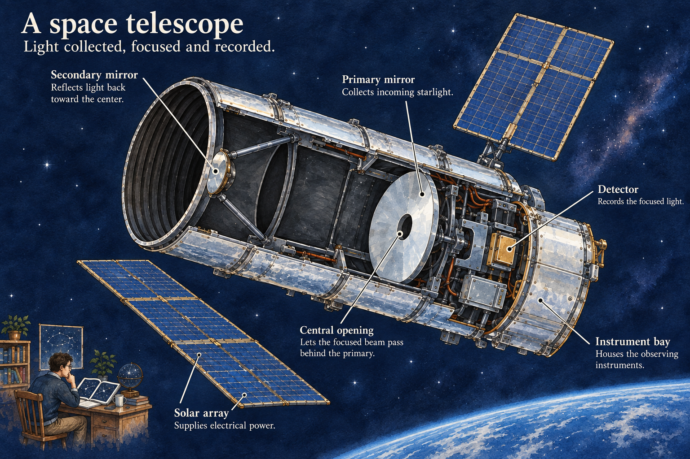
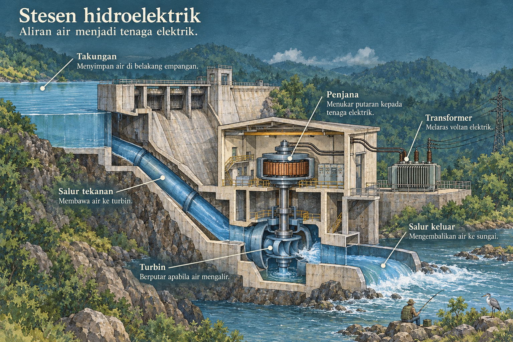
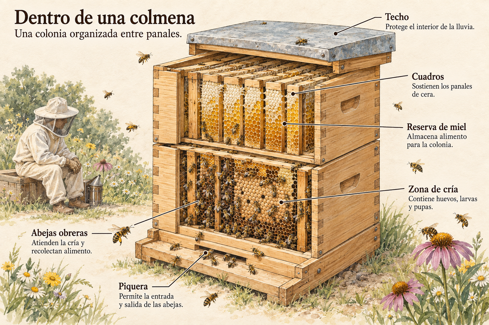
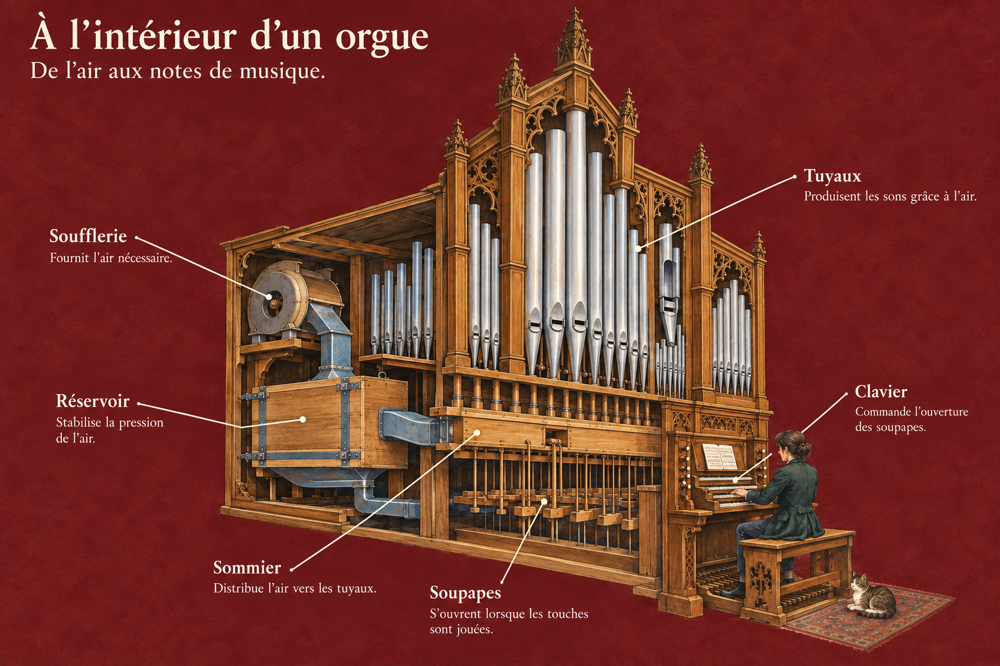
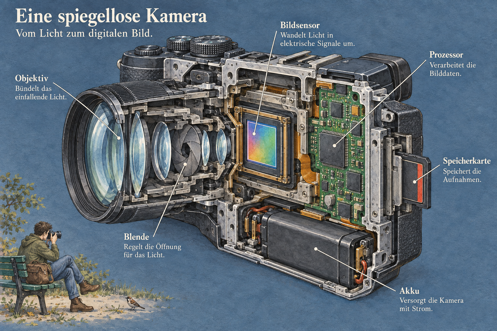
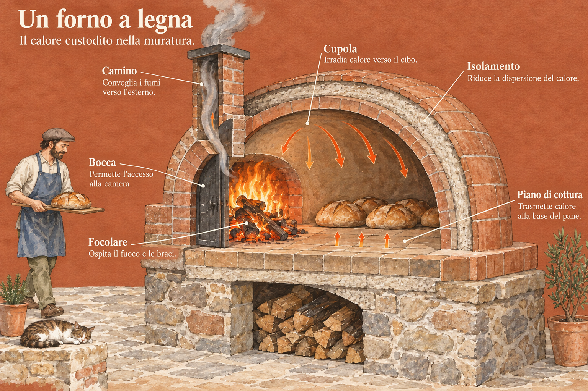
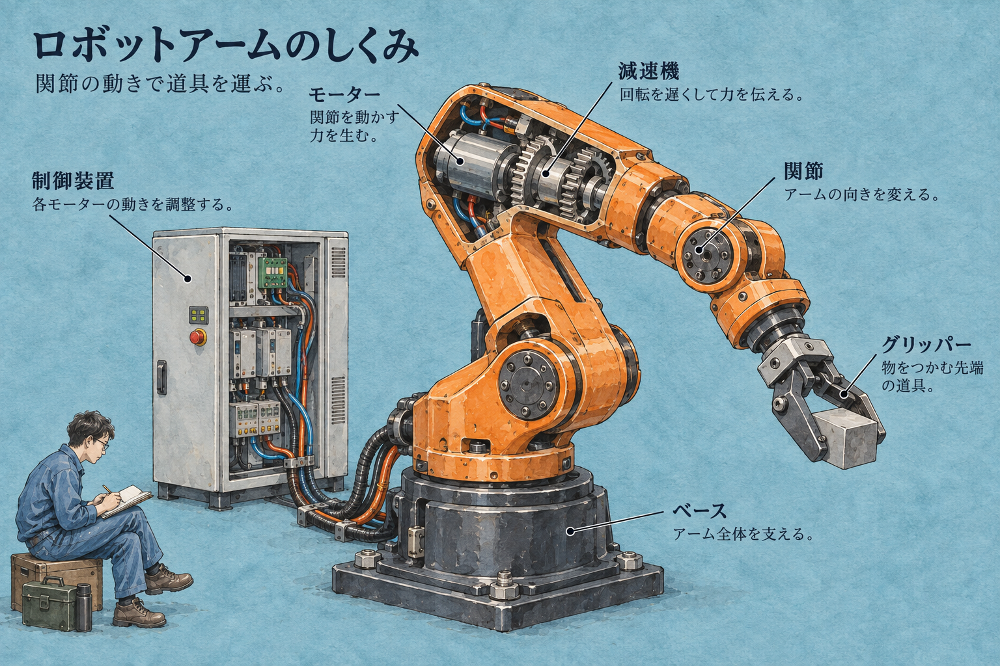
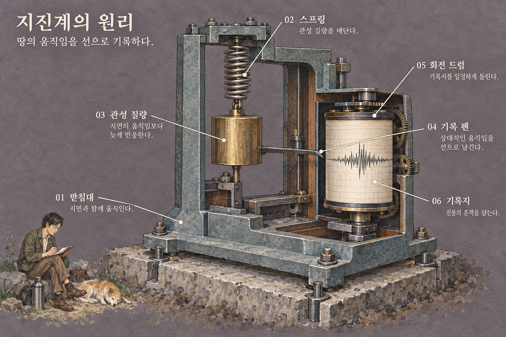
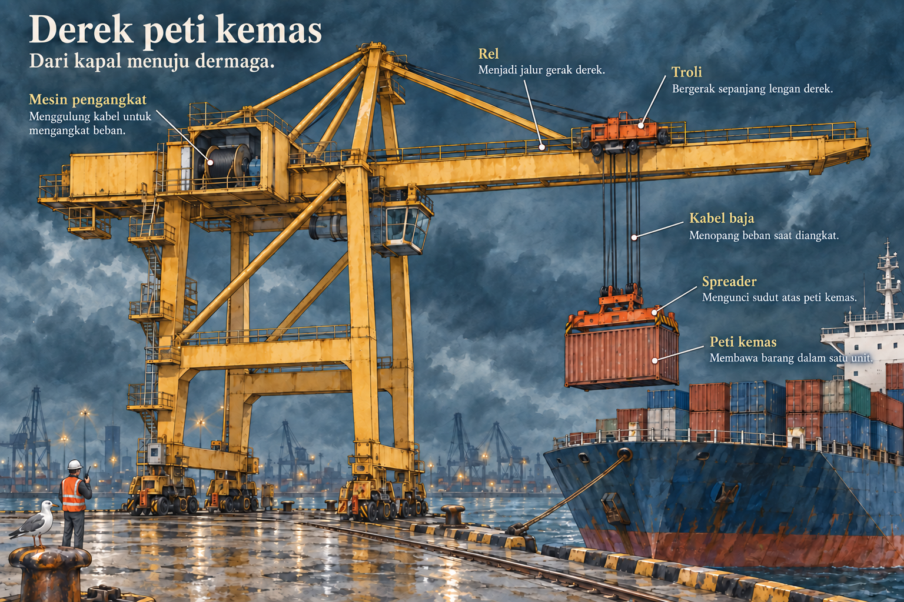
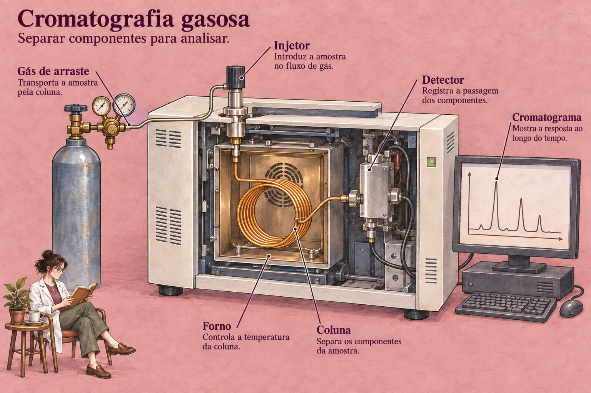

# Ten languages, ten domains

These are generic conceptual illustrations made with the included skill. Prompts specify exact lettering and mechanism constraints. The image review is a model visual check, not native-speaker proofreading or engineering certification. See [manifest.json](manifest.json) for every full prompt, caption, source and recorded edit.

## 1. A space telescope

English · Astronomy · ink-indigo paper

The optical path returns through the opening in the primary mirror to a detector behind it. Primary source: [science.nasa.gov](https://science.nasa.gov/mission/hubble/observatory/design/optics/).

## 2. Stesen hidroelektrik

Bahasa Melayu · Energy · misty slate-teal paper

Water and electrical paths are separate: penstock → turbine → tailrace; the turbine shaft drives the generator. Primary source: [energy.gov](https://www.energy.gov/cmei/water/how-hydropower-works).

## 3. Dentro de una colmena

Español · Ecology · honey-peach paper

Honey frames and brood frames occupy distinct regions of a generic managed hive. Primary source: [extension.psu.edu](https://extension.psu.edu/beekeeping-honey-bees).

## 4. À l'intérieur d'un orgue

Français · Music · muted burgundy paper

Wind reaches a windchest; a key-operated valve admits air to the selected pipe. Mechanical tracker rods are separate from the wind supply. Primary source: [yamaha.com](https://www.yamaha.com/en/musical_instrument_guide/pipeorgan/mechanism/mechanism002.html).

## 5. Eine spiegellose Kamera

Deutsch · Photography · graphite-blue paper

A mirrorless optical path reaches the sensor directly, with no reflex mirror. Primary source: [global.canon](https://global.canon/en/quality/story/2024-high-image-quality.html).

## 6. Un forno a legna

Italiano · Cooking · brick terracotta paper

The cutaway distinguishes the refractory dome, insulation, cooking floor and front chimney. Primary source: [fornobravo.com](https://www.fornobravo.com/tech-resources/oven-operation/).

## 7. ロボットアームのしくみ

日本語 · Robotics · smoky cyan paper

A motor and reduction gear drive a joint; a controller connects electrically through the base. Primary source: [new.abb.com](https://new.abb.com/products/robotics/controllers).

## 8. 지진계의 원리

한국어 · Geophysics · plum-gray paper

The frame follows ground movement while a spring-suspended mass and stylus record relative motion on a rotating drum. Primary source: [usgs.gov](https://www.usgs.gov/programs/earthquake-hazards/seismographs-keeping-track-earthquakes).

## 9. Derek peti kemas

Bahasa Indonesia · Logistics · stormy petrol paper

The trolley travels along the boom; hoist ropes support a spreader attached to the container. Primary source: [liebherr.com](https://www.liebherr.com/en-us/maritime-cranes/products/port-equipment/ship-to-shore-container-cranes-4433170).

**Visible limitation:** after two targeted edits, the `Rel` leader still ends near the upper rail/guardrail region instead of isolating the trolley running track clearly. This selection demonstrates the visual style; that callout needs further subject-expert correction for teaching use.

## 10. Cromatografia gasosa

Português · Analytical chemistry · dusty rose paper

Carrier gas passes through the injector, column and detector; the detector signal goes electronically to the display. Primary source: [shimadzu.com](https://www.shimadzu.com/an/products/gas-chromatography/index.html).
